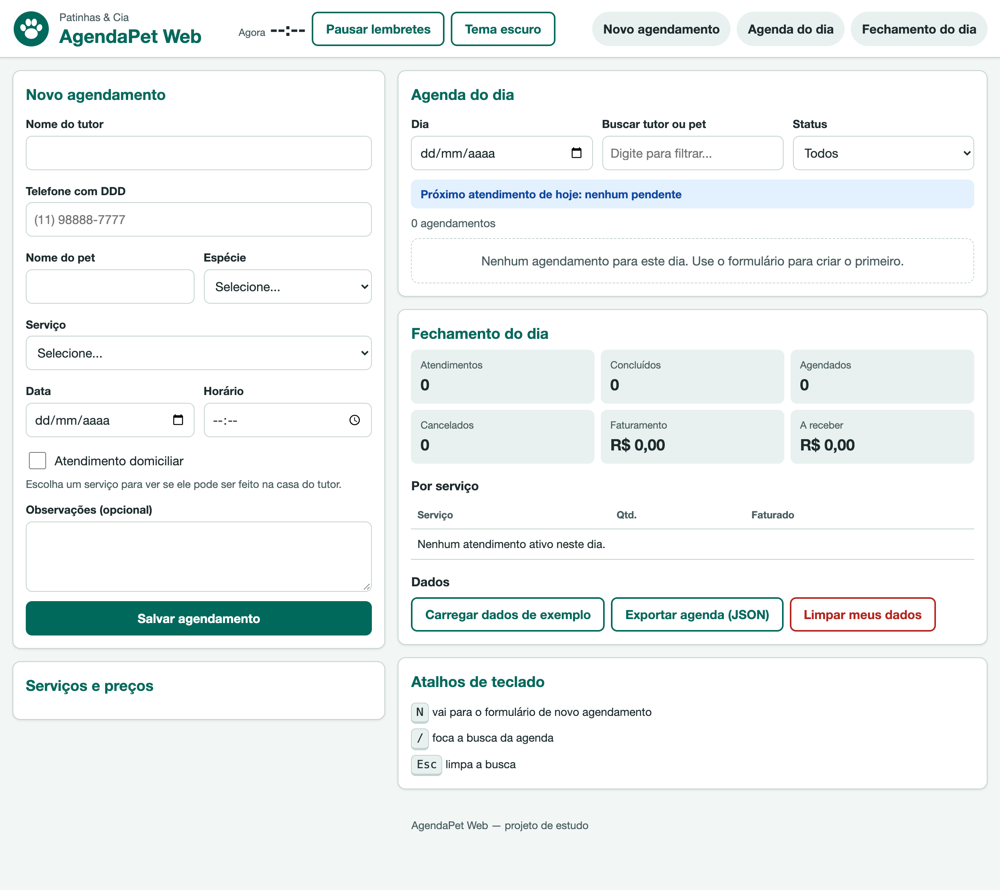
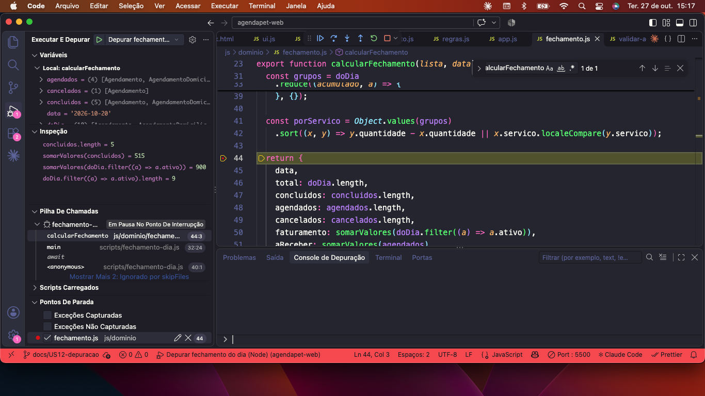

# AgendaPet Web 🐾

Painel web de agendamentos do pet shop Patinhas & Cia (empresa fictícia): a atendente agenda banho, tosa, consultas e hospedagem pelo celular ou tablet, e a dona da loja fecha o caixa do dia no navegador e no terminal.

> 📋 **Quadro Kanban:** https://github.com/users/dressaadrc-rgb/projects/1/views/1
> 🌐 > 🌐 **GitHub Pages (bônus):** https://dressaadrc-rgb.github.io/agendapet-web/
> 📁 **Repositório:** https://github.com/dressaadrc-rgb/agendapet-web

## 1. O que o sistema faz e para quem serve

Hoje a Patinhas & Cia marca os atendimentos por WhatsApp e caderno, o que causa horários duplicados, atendimentos em feriados sem aviso, endereços errados nas visitas a domicílio e nenhuma noção de quanto o dia rendeu. O AgendaPet Web resolve isso para três pessoas:

- **Bia, a atendente:** vê o catálogo de serviços, agenda com validação (data, horário de funcionamento, telefone), preenche o endereço só com o CEP, é avisada quando a data é feriado, acompanha a agenda do dia (busca, filtro, concluir/cancelar) e recebe lembretes dos próximos atendimentos.
- **Seu Henrique, o dono:** vê o fechamento do dia (faturamento só do que foi concluído, quanto ainda vai receber e atendimentos por serviço), no navegador e também pelo terminal.
- **Rafael, que usa só o teclado:** consegue operar tudo com Tab, Enter e os atalhos N, / e Esc, com foco sempre visível.



## 2. Como executar (do zero)

Pré-requisitos: **Node.js 20 ou superior** (desenvolvido com o v22.23.2) e **Git**.

```bash
git clone https://github.com/dressaadrc-rgb/agendapet-web.git
cd agendapet-web
npm install
npm start
```

A página abre sozinha em `http://localhost:5500`. Ela precisa ser aberta pelo servidor local, e não com duplo clique no `index.html`, porque os módulos (ESM) e o `fetch` não funcionam com `file://`.

| Comando | O que faz |
|---|---|
| `npm start` | Sobe o servidor local (`http-server`, porta 5500, sem cache) e abre a página |
| `npm run fechamento` | Imprime no terminal o fechamento de 20/10/2026 a partir de `data/agenda-exemplo.json` |
| `npm run validar` | Valida `data/agenda-exemplo.json` e mostra `[OK]` |
| `npm run validar:erro` | Valida `data/agenda-invalida.json`, lista os 7 problemas e termina com código 1 |
| `npm test` | Roda os testes das regras de negócio com o executor nativo do Node (`node --test`) |

O fechamento também aceita outros dias e arquivos: `node scripts/fechamento-dia.js --data=2026-10-21 --arquivo=data/agenda-exemplo.json`.

## 3. Decisões de negócio

| Decisão | Valor | Onde está no código |
|---|---|---|
| Horário de funcionamento (RN01) | 08:00 às 18:00, de 30 em 30 min; o serviço precisa terminar até 18:00 (banho e tosa de 120 min não começa depois de 16:00) | `CONFIG` em `js/dominio/agendamento.js`; `dentroDoFuncionamento()` em `js/dominio/regras.js` |
| Conflito de horário (RN02) | Não pode haver dois agendamentos **ativos** (Agendado ou Concluído) no mesmo dia e horário; cancelado libera o horário | `conflitaCom()` na classe `Agendamento`; `temConflito()` em `regras.js` |
| Taxa domiciliar (RN03) | R$ 15 se a cidade for São Paulo; R$ 30 em outra cidade (comparando sem acento e sem diferenciar maiúsculas). Adestramento e hospedagem são só na loja | `taxaDeslocamento()` na classe `AgendamentoDomiciliar`; `CONFIG` |
| Status (RN05) | Nasce "Agendado"; pode virar "Concluído" ou "Cancelado" e depois fica travado | `alterarStatus()` na classe `Agendamento` |
| Faturamento (RN06) | Soma só os **concluídos**; "a receber" soma os agendados; cancelados não entram em valor; "por serviço" conta os ativos | `calcularFechamento()` em `js/dominio/fechamento.js` |
| Protocolo (RN07) | `AP-0001`, `AP-0002`... sequencial, continuando do maior número salvo | `criarGeradorProtocolo()` e `maiorNumeroProtocolo()` em `agendamento.js` |
| Feriados (RN08) | Em feriado nacional, só salva marcando "Agendar mesmo assim" | `aoEscolherData()` e `aoEnviarFormulario()` em `js/app.js` |
| Validade do cache de feriados | 30 dias, uma chave por ano (`agendapet:feriados:2026`) | `buscarFeriados()` em `js/api.js` |
| Lembrete (RN09) | Quando faltam 15 min ou menos; "Atrasado" = ainda Agendado e o horário já passou | `CONFIG.lembreteMin`; `estaAtrasado()` em `fechamento.js`; `atualizarAvisos()` em `app.js` |
| Quando as APIs falham | Catálogo: mensagem com "Tentar novamente". ViaCEP: mensagem própria para formato, CEP inexistente, sem rede e serviço fora; o endereço continua editável. BrasilAPI: aviso de indisponibilidade, sem bloquear | `js/api.js` (`ErroApi` com `tipo`); `mensagemErroCatalogo()` e `mensagemErroCep()` em `app.js` |

## 4. Conceitos do Módulo 01: onde foram aplicados

| Conceito | Arquivo e função |
|---|---|
| HTML semântico, acessibilidade e SEO | `index.html`: `header`, `nav`, `main`, `section`, `aside`, `footer`; skip link; um único `h1`; `lang`, `title` e `meta description`; `label for`; `aria-invalid`, `aria-live`, `role="status"`, `aria-expanded`, `aria-pressed` |
| Formulários + JavaScript | `aoEnviarFormulario()` e `lerFormulario()` em `app.js` (`preventDefault`, `novalidate`); `validarAgendamento()` em `regras.js`; `mostrarErros()` em `ui.js` |
| CSS, Flexbox, variáveis e responsividade | `css/style.css`: variáveis em `:root`, tema escuro em `:root[data-tema="escuro"]`, mobile-first com breakpoints em 640 e 1024 px, `:focus-visible`, sem `!important` e sem seletor de id |
| DOM e seletores | `ui.js`: `createElement`, `textContent` (nunca `innerHTML`), `classList`, `dataset`, `replaceChildren`, `querySelector` |
| Eventos de mouse e teclado | `aoClicarNaLista()` (delegação com `closest`), `aoPassarMouse()` (`mouseover`/`mouseout`) e `aoApertarTecla()` (atalhos N, / e Esc) em `app.js` |
| `fetch`, Promises e `async/await` | `buscarJSON()`, `carregarServicos()`, `buscarCep()` e `buscarFeriados()` em `api.js`; `carregarCatalogo()` em `app.js` |
| `localStorage` | `js/storage.js` (`lerJSON` e `salvarJSON` com `try/catch`, `limparDados` só do prefixo); `salvarAgenda()` e `restaurarAgenda()` em `app.js` |
| `setTimeout` / `setInterval` | `mostrarToast()` em `ui.js` (`setTimeout`); `iniciarLembretes()` e `aoAlternarLembretes()` em `app.js` (`setInterval`/`clearInterval`); confirmação do "Limpar meus dados" |
| Classes, construtor e `this` | `Servico` e `Agendamento` em `js/dominio/agendamento.js` (getters `ativo`, `inicio`, `tipo`) |
| Herança (`extends`/`super`) | `AgendamentoDomiciliar extends Agendamento` (sobrescreve `calcularValor` com `super.calcularValor() + taxa`); `ErroApi extends Error` em `api.js` |
| Closure | `criarGeradorProtocolo()` em `agendamento.js`: o `contador` fica guardado na função devolvida |
| Callback | `filtrarAgendamentos(lista, ...criterios)` e as fábricas de critérios `porData`, `porStatus` e `porBusca` em `fechamento.js`; botão "Tentar novamente" em `mostrarEstado()` |
| Métodos de array (mínimo 4) e laços | `map`, `filter`, `find`, `reduce`, `sort`, `every`, `some` e `forEach` em `fechamento.js` e `ui.js`; laço `for...of` em `restaurarAgenda()`; laço duplo `for` em `scripts/validar-agenda.cjs` |
| `const`, `let` e `var` | Usei `const` sempre que o valor não muda (ex.: `PREFIXO`, `estado`, `CONFIG`) e `let` só quando muda (ex.: `contador` do protocolo, `ultimoCep`, timers). Não usei `var` porque ela "vaza" para fora dos blocos `{ }` e pode ser usada antes de ser criada (hoisting), o que esconde erros. |
| Módulos ESM | `import`/`export` em todo o `js/`; `<script type="module">` no `index.html`; `"type": "module"` no `package.json` |
| Node.js, npm e CommonJS | `scripts/fechamento-dia.js` (ESM), `scripts/validar-agenda.cjs` (CommonJS), `http-server` como devDependency, `tests/dominio.test.js` com `node --test` |

## 5. Arquitetura cliente-servidor

O **cliente** é o navegador, que roda o HTML, o CSS e o JavaScript. Os **servidores** respondem aos pedidos (requisições HTTP) que o cliente faz com `fetch`:

```
Navegador (cliente)
 └─ index.html ── <script type="module"> ──► js/app.js (estado + eventos)
                                              ├─ js/ui.js       desenha a tela
                                              ├─ js/storage.js  localStorage (no próprio navegador)
                                              ├─ js/dominio/*   regras puras (sem DOM)
                                              └─ js/api.js      fetch ──┬─► servidor local (http-server): data/servicos.json
                                                                        ├─► ViaCEP: endereço pelo CEP
                                                                        └─► BrasilAPI: feriados do ano

Terminal (Node.js)
 ├─ scripts/fechamento-dia.js (ESM) ──► js/dominio/*  (as MESMAS regras da página)
 └─ scripts/validar-agenda.cjs (CJS) ──► js/dominio/* via await import()
```

O servidor local (`npm start`) entrega os arquivos do projeto. A ViaCEP e a BrasilAPI são servidores públicos na internet; as consultas enviam só o CEP e o ano. Os dados dos agendamentos ficam apenas no navegador (localStorage).

## 6. Gerenciadores de pacotes: instalação global vs local

- **Local** (`npm install --save-dev http-server`): instala dentro do projeto, na pasta `node_modules/`, e registra em `devDependencies` no `package.json` e no `package-lock.json`. Quem clonar o projeto só precisa rodar `npm install` para ter as mesmas versões. É o que o projeto usa.
- **Global** (`npm install -g pacote`): instala na máquina inteira, fora do projeto. Serve para ferramentas que você usa em qualquer pasta, mas não fica registrada no projeto, então outra pessoa não recebe a ferramenta ao clonar.
- **`npx`**: roda um pacote sem instalar (ex.: `npx http-server --help`).
- **`node_modules/` fora do Git:** está no `.gitignore`, porque é grande e pode ser recriado pelo `npm install` a partir do `package-lock.json`.

```bash
npm ls                  # pacotes do projeto
npm ls -g --depth=0     # pacotes globais da máquina
npx http-server --help  # roda sem instalar
```

Resultado na minha máquina:

```
$ npm ls
agendapet-web@1.0.0 /Users/macbookdeandressa/Desktop/agendapet-web
└── http-server@14.1.1

$ npm ls -g --depth=0
/usr/local/lib
├── corepack@0.34.6
└── npm@10.9.8
```

O `http-server` aparece só no `npm ls` (instalação local, registrada no `package.json` como devDependency) e não no global. No global ficam apenas o `npm` e o `corepack`, que vêm com o próprio Node.js. Por isso qualquer pessoa que clonar o projeto recebe o `http-server` só rodando `npm install`.

## 7. CommonJS vs ESM

| | CommonJS | ESM |
|---|---|---|
| Sintaxe | `const x = require('./x')` e `module.exports = { ... }` | `import { x } from './x.js'` e `export function x()` |
| Extensão | `.cjs`, ou `.js` sem `"type": "module"` | `.mjs`, ou `.js` com `"type": "module"` |
| `"type"` no `package.json` | ausente ou `"commonjs"` | `"module"` (é o caso deste projeto) |
| Carregamento | Síncrono; tem `__dirname`; para usar um módulo ESM, só com `await import()` | Assíncrono; não tem `__dirname` (usa `import.meta.url`); importa CommonJS normalmente |
| Funciona no navegador? | Não | Sim, com `<script type="module">` |

**Por que o projeto usa ESM?** Porque é o único formato que roda no navegador **e** no Node. Assim as regras de negócio de `js/dominio/` foram escritas uma vez só e usadas na página (`app.js`), no terminal (`fechamento-dia.js`) e nos testes (`dominio.test.js`). O `npm run fechamento` mostra os mesmos R$ 515,00 da tela porque é o mesmo código. O `validar-agenda.cjs` está em CommonJS de propósito, para mostrar a diferença: ele precisa do `await import()` para carregar as regras.


## 8. Especificidade no CSS: um conflito real

Alguns elementos da página começam escondidos com o atributo `hidden` (o aviso de feriado, o bloco de endereço, o lembrete e o toast) e só aparecem quando o JavaScript precisa deles. Mas as classes desses elementos definem um `display`, por exemplo `.endereco { display: flex; }`.

O conflito: o seletor de atributo `[hidden]` e o seletor de classe `.endereco` têm a **mesma especificidade** (0,1,0). Quando dois seletores empatam, vence a regra que aparece **por último** no arquivo. Para confirmar, movi temporariamente a regra `[hidden] { display: none; }` do final do `style.css` para o começo: o bloco de endereço passou a aparecer mesmo sem marcar "Atendimento domiciliar", porque o `display: flex` da classe venceu. Voltei a regra para o lugar.

A solução, sem `!important` e sem seletor de id, é declarar `[hidden] { display: none; }` **por último** no arquivo. Assim, com a mesma especificidade, o `hidden` sempre vence.

Também evitei o outro tipo de conflito comum: seletores de tag aninhados (como `.agenda button`, especificidade 0,1,1) que vencem uma classe simples e fazem "o estilo não pegar". O CSS usa só classes no padrão BEM (`.topo__titulo`, `.campo__entrada`, `.botao--principal`), fornecidas pelo professor. Adaptei as classes do HTML a esse padrão, o que mantém a especificidade baixa e previsível.

## 9. Depuração

Relatório completo em [docs/bug-report.md](docs/bug-report.md).

Configurei o `.vscode/launch.json` com duas configurações do Node ("Depurar fechamento do dia" e "Depurar validador da agenda"). Para praticar o método **reproduzir → hipótese → evidência → causa raiz → correção**, introduzi de propósito um erro no faturamento (somava os agendados junto com os concluídos: R$ 900,00 em vez de R$ 515,00). O `npm test` acusou o erro (`900 !== 515`); com um breakpoint no `return` do `calcularFechamento`, o Watch e a Call Stack mostraram que a linha usava os atendimentos **ativos** em vez dos **concluídos**. Também usei breakpoint condicional e logpoint. A correção está no commit `6b7ce44` (PR #27).



Bugs reais que encontrei durante a sprint e corrigi lendo o Console do navegador:
- Um `import` com caminho errado (`../dominio/...` em vez de `./dominio/...`) gerava 404 e impedia todo o JavaScript de rodar.
- A função `iniciar` declarada duas vezes ("Identifier has already been declared") ao substituir código.
- A agenda salva no localStorage com a chave `undefined`, por um nome de propriedade escrito errado no objeto `CHAVES`.

## 10. Sprint: planejado × entregue

| | |
|---|---|
| Tickets planejados | 12 (US01 a US12) |
| Pontos planejados | 52 |
| Pontos entregues | 52 |
| O que ficou de fora e por quê | não fiz estilos de impressão próprios (o CSS do professor já traz um `@media print`). Os testes com `node --test` e o download da agenda em JSON (Blob) foram feitos |
| Branches / Pull Requests | 15 branches e 15 Pull Requests, todos integrados à `main` |

Detalhes em [planejamento/sprint-planning.md](planejamento/sprint-planning.md).

Mudanças durante a sprint: o prazo de entrega passou de 02/11 para 03/11 (aviso do professor em aula) e a apresentação foi antecipada de 30/10 para 29/10, a meu pedido, com aprovação do professor. Terminei as histórias antes do cronograma previsto.

### Retrospectiva


- **O que manter:** um ticket por branch, com PR e o modelo preenchido; testar as regras de negócio no Node antes de ligar na tela (os testes pegaram o bug do faturamento sozinhos); ler o Console sempre que algo parava de funcionar, porque ele indicava o arquivo e a linha exatos.
- **O que parar de fazer:** Dupliquei functions e o JavaScript inteiro parava de rodar
- **O que começar a fazer:** conferir com Cmd+F se cada função aparece uma vez só antes de salvar; ler os comandos da documentação considerando a versão das ferramentas (o `node --test tests/` do Refinamento não funciona no Node 22, e precisei usar `node --test tests/*.test.js`); quando um push com imagens falhar com "HTTP 400", aumentar o `http.postBuffer` do Git.

## 11. Extensões do VS Code


## 11. Extensões do VS Code

Usadas neste projeto:

| Extensão | Para que usei |
|---|---|
| **Live Server** (Ritwick Dey) | Servidor local com recarga automática (botão "Go Live"), como alternativa ao `npm start` |
| **Prettier – Code formatter** | Formatação automática do código (indentação e espaçamento padronizados) |
| **Node.js Modules Intellisense** | Autocompleta nomes de módulos nos `import` e `require` |
| **Claude Code for VS Code** (Anthropic) | Assistente de IA (ver a seção 13) |
| **Portuguese (Brazil) Language Pack** | Interface do VS Code em português |
| **Material Icon Theme** | Ícones por tipo de arquivo e pasta na lateral, o que facilita achar os arquivos |
| **Dracula Theme** e **Omni Theme** | Temas escuros do editor |

Também tenho instalada a **Rainbow CSV**, mas ela não foi usada neste projeto, que não tem arquivos CSV.

O depurador usado na US12 (breakpoints, Watch e Call Stack) já vem embutido no VS Code, sem extensão.

## 12. Estrutura do projeto

```
agendapet-web/
├── .github/pull_request_template.md
├── .vscode/launch.json
├── css/style.css
├── data/
│   ├── agenda-exemplo.json
│   ├── agenda-invalida.json
│   └── servicos.json
├── docs/
│   ├── bug-report.md
│   ├── depuracao.png
│   ├── depuracao-bug.png
│   ├── depuracao-logpoint.png
│   └── tela-1280.png
├── img/
│   ├── favicon.svg
│   └── logo.svg
├── js/
│   ├── api.js
│   ├── app.js
│   ├── storage.js
│   ├── ui.js
│   └── dominio/
│       ├── agendamento.js
│       ├── fechamento.js
│       └── regras.js
├── planejamento/sprint-planning.md
├── scripts/
│   ├── fechamento-dia.js
│   └── validar-agenda.cjs
├── tests/dominio.test.js
├── .gitignore
├── index.html
├── package.json
├── package-lock.json
└── README.md
```

## 13. Uso de IA

- **Onde ajudou:** usei a ferramenta como apoio para entender os documentos do projeto e os requisitos de cada história, configurar o Git e o GitHub (repositório, branches, Pull Requests e Kanban), esclarecer conceitos de programação e consultar exemplos iniciais de HTML, JavaScript e scripts de Node.js com base nos esqueletos do Refinamento Técnico. Também contei com ajuda para organizar os textos dos PRs, o relatório de bug e este README.
- **O que fiz e validei por conta própria:** revisei e adaptei o código ao projeto, executei os cenários de aceite no Chrome e no terminal e conferi manualmente os resultados, incluindo os valores de R$ 515,00 de faturamento e R$ 385,00 a receber. Também verifiquei o funcionamento das implementações e ajustei o que foi necessário durante o desenvolvimento.
- **Correções e aprendizados:** durante a implementação, precisei corrigir caminhos de importação, remover funções duplicadas, ajustar o nome de uma propriedade em CHAVES e eliminar tags extras no HTML. Também adaptei as classes do HTML ao CSS fornecido pelo professor e ajustei o comando de testes para o Node.js 22. Além disso, nem todas as sugestões da IA estavam corretas: em uma ocasião, ela sugeriu um logpoint em uma linha na qual a variável itens ainda não existia. Ao testar a sugestão, identifiquei o erro itens is not defined e utilizei o Watch do depurador para verificar a expressão no momento adequado.
- **Conclusão:** a IA foi utilizada como ferramenta de consulta e apoio, mas o desenvolvimento envolveu análise dos requisitos, revisão e adaptação do código, execução de testes, conferência dos resultados e correção de erros. O processo também me ajudou a compreender melhor os conceitos aplicados e as decisões tomadas durante a implementação